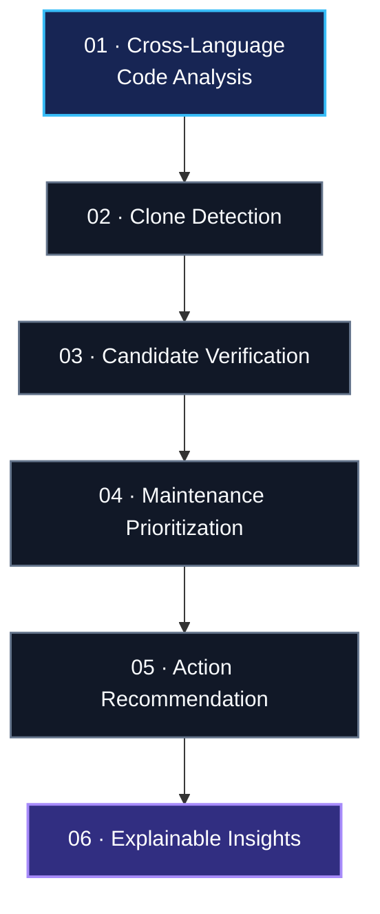

# Hi there, I'm Abida Sultana 

  

  
  
  

  

---

## ✦ About Me

I'm a **Computer Science and Engineering undergraduate at the University of Liberal Arts Bangladesh (ULAB)**, passionate about building intelligent software and exploring research problems at the intersection of AI and software security.

My goal is to combine software engineering, machine learning, and explainable AI to develop systems that are not only intelligent, but also secure, understandable, and useful in real-world development.

- 🎓 CSE undergraduate at ULAB
- 🧠 Exploring Artificial Intelligence, Machine Learning, and Deep Learning
- 🔬 Interested in Explainable AI and intelligent code analysis
- 🔐 Exploring AI-driven security and software supply chain security
- 💻 Building projects with modern web technologies and APIs
- 🧪 Working on research-oriented cross-language code clone analysis
- 🌱 Continuously strengthening my foundations in AI/ML and research methodology

> *Curious by nature. Research-driven by ambition. Building one step at a time.*

---

## 🔬 Research Interests

  
  
  
  
  

  <b>Code Intelligence</b> · <b>Cross-Language Clone Detection</b> ·
  <b>Software Maintenance</b> · <b>Secure Software Engineering</b> ·
  <b>Software Supply Chain Security</b>

---

## 🧪 Featured Research Project

### Beyond Clone Detection: An Explainable Multi-Language Framework for Clone Analysis and Maintenance Decision Support

  
  
  

I'm exploring how code intelligence and machine learning can help developers identify, verify, understand, and prioritize code clones across programming languages.

**The framework's core workflow:**

**Research focus areas**

- 🔍 Identifying potential Java–Python code clone relationships
- 🧩 Exploring semantic code representations and embeddings
- 🤖 Investigating machine-learning-based clone verification
- 📊 Combining code metrics with structural and semantic information
- 🎯 Prioritizing clones for potential maintenance attention
- 💡 Making analysis results more interpretable and actionable

**Long-term vision:** Move beyond identifying similar code toward helping developers understand why similarities matter and what actions may be appropriate.

---

## 🛠️ Tech Stack

### Programming Languages

  

### Web Development

  

### Development Tools

  

### Current Learning Focus

  
  
  
  

---

## 🏆 Achievements

  
  
  

---

## 📊 GitHub Analytics

  
  

  

## 📊 GitHub Contribution Summary

  

---

## 🤝 Let's Connect

I'm always happy to connect with people interested in AI research, software engineering, code intelligence, and meaningful technology projects.

  
  
  

  

  <i>"Build with curiosity. Research with purpose. Improve with every iteration."</i>

